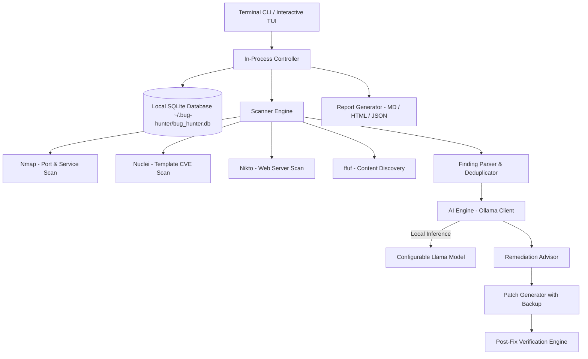

# 🐺 Bug Hunter AI

> **“Find. Explain. Fix. Verify.”**  
> 100% Local Terminal-First AI Cybersecurity Bug-Finding & Defensive Remediation Assistant.

---

## 🔒 100% Terminal-Only & Local-First

**Bug Hunter AI** runs completely in your terminal without requiring any web server, browser, or localhost port bindings.

- **Pure Terminal Interface**: All scanning, AI reasoning, finding exploration, patch review, and fix verification happen directly in your CLI/TUI.
- **In-Process Architecture**: Subprocess scanners, Ollama client, and SQLite database run directly inside the Python process.
- **Zero Cloud Leakage**: No telemetry, no external network requests, and zero cloud uploads. All data is kept locally on your machine in `~/.bug-hunter/`.
- **Strict Authorization Safeguards**: Scanning requires explicit user confirmation before any network traffic or tool execution.
- **Safe Remediation Engine**: AI generates step-by-step guidance and syntax-highlighted diffs. Patches are never auto-applied without manual approval, and automatic backups are created prior to any change.

---

## 🏛️ System Architecture



---

## 📦 Supported Platforms

- **macOS** (Apple Silicon & Intel)
- **Linux** (Debian, Ubuntu, Fedora, Arch, etc.)

---

## 🚀 Quick Start

### 1. Installation

Run the automated installer:
```bash
./install.sh
```

Or install manually:
```bash
python3 -m venv .venv
source .venv/bin/activate
pip install -r requirements.txt
```

### 2. Running Bug Hunter

Start the interactive terminal assistant:
```bash
./run.sh
```

---

## 💻 Terminal Commands

### 1. Interactive Dashboard Menu
```bash
./run.sh
# or
python3 -m cli.main interactive
```

Provides a numbered interactive menu:
1. Quick System Status & Tool Check
2. Start Security Scan
3. View Findings & AI Explanations
4. AI Remediation & Patch Review
5. Verify Security Fixes
6. Manage Targets
7. Generate Report (Markdown/HTML/JSON)
8. View Local Activity Log
9. Configuration Settings

### 2. Direct CLI Commands
```bash
# Check system status and installed tools
python3 -m cli.main status

# Check scanner availability and installation commands
python3 -m cli.main tools

# Run an authorized scan directly
python3 -m cli.main scan 127.0.0.1 --tools nmap,nuclei,nikto,ffuf --authorize

# List discovered security findings
python3 -m cli.main findings --severity HIGH

# Generate and export a report directly to file
python3 -m cli.main report <SCAN_ID> --format markdown --output assessment.md

# View configuration
python3 -m cli.main config
```

---

## 🛡️ Security Scanners Supported

| Tool | Category | Purpose | Installation (macOS) | Installation (Linux) |
|---|---|---|---|---|
| **Nmap** | Network | Port scanning, service detection | `brew install nmap` | `sudo apt install nmap` |
| **Nuclei** | Vulnerability | Template CVE & misconfiguration scan | `brew install nuclei` | `go install github.com/projectdiscovery/nuclei/v3/cmd/nuclei@latest` |
| **Nikto** | Web Server | Outdated software, dangerous files | `brew install nikto` | `sudo apt install nikto` |
| **ffuf** | Web Discovery | Authorized content and path fuzzing | `brew install ffuf` | `go install github.com/ffuf/ffuf/v2@latest` |
| **Ollama** | AI Engine | Local AI reasoning & remediation | `brew install ollama` | `curl -fsSL https://ollama.com/install.sh \| sh` |

---

## 🧪 Running Automated Tests

```bash
python3 -m pytest -v
```

---

## 📜 Ethical Use & Legal Disclaimer

> **IMPORTANT**: Bug Hunter AI is created exclusively for authorized vulnerability assessment, educational research, defensive security auditing, and local development system hardening.  
> You must **never** scan systems, networks, websites, or IP addresses without explicit, documented authorization from the owner.
